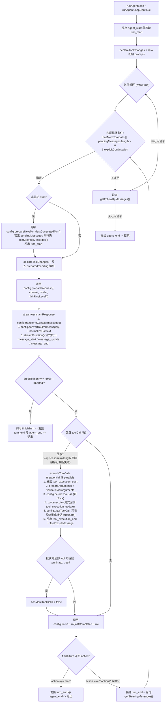

# Pi Agent 源码结构与 `@anthropic-ai/sandbox-runtime` 接入调研

- **关联工单**：[#3 调研 Pi Agent 源码结构与 sandbox-runtime 接入方式](https://github.com/penguinyzsh/hyori-agent/issues/3)（父工单：[#1 Hyori 架构设计与规格规划](https://github.com/penguinyzsh/hyori-agent/issues/1)）
- **调研基线版本**：
  - [`earendil-works/pi`](https://github.com/earendil-works/pi)：`v1.4.0`（`@earendil-works/pi-*`，继承自原 `@mariozechner/pi-*` `0.73.1`，要求 Node.js `>=22.19.0`）
  - [`anthropics/sandbox-runtime`](https://github.com/anthropics/sandbox-runtime)：`@anthropic-ai/sandbox-runtime@0.0.81`（要求 Node.js `>=22.12.0`）

---

## 1. 结论速览

1. **Pi Agent 命名空间与包结构**：上游仓库已从 `@mariozechner/pi-*` 演进为 `earendil-works/pi` 下的 `@earendil-works/*` Monorepo（当前 `1.4.0`）。核心分层为 `@earendil-works/pi-ai`（多模型统一流式协议与消息归一化）、`@earendil-works/pi-schema`（无 `eval` 的 JSON Schema 校验）、`@earendil-works/pi-agent-core`（无 UI 耦合的双层 Agent Loop 状态机与工具执行管线）和 `@earendil-works/pi-coding-agent`（包含 `SessionManager` 树状 JSONL 会话持久化、上下文压缩 `compaction`、内置文件/命令工具工厂与 `ExtensionRunner` 插件体系）。
2. **`Omote` 与 `Ura` 的复用与扩展边界**：
   - **`Omote` 直接复用**：`@earendil-works/pi-ai`、`@earendil-works/pi-agent-core`（含 `Agent` 状态管理、`steeringQueue` / `followUpQueue` 消息队列与生命周期钩子）、以及 `@earendil-works/pi-coding-agent` 中的 `SessionManager`、`compaction` 和内置工具工厂（`createReadTool`、`createWriteTool`、`createEditTool`、`createBashTool`）。
   - **`Omote` 替换与扩展**：移除 `@earendil-works/pi-tui` 及 `InteractiveMode`，替换为面向 Web 与 Telegram 的通道层；通过订阅 `AgentEvent` 流与注册自定义 `AgentTool` 驱动 **Channel Action（通道动作）**（已读回执、正在输入状态、表情回应、贴纸、多段拆分发送）。
   - **`Ura` 协同钩子接入**：在 `prepareRequest` / `transformContext`（或 `ExtensionRunner` 的 `before_agent_start` / `context`）阶段注入 `Ura` 的 **Intent Analysis（意图分析）** 结果与长期记忆检索片段；在 `finishTurn` / `agent_end` / `session_before_compact` 阶段触发 `Ura` 的异步记忆提炼、自省与后台自主任务。
3. **无容器 `Sandbox（沙盒）` 接入方式**：Pi 原生不提供操作系统级沙盒（其 `bash` 工具直接调用 `child_process.spawn`）。可通过实现 `@earendil-works/pi-coding-agent` 暴露的 `BashOperations` 接口，在内部调用 `@anthropic-ai/sandbox-runtime` 的 `SandboxManager.wrapWithSandboxArgv()`。在 macOS 上基于 `/usr/bin/sandbox-exec`（Seatbelt SBPL）、在 Linux 上基于 `bwrap`（bubblewrap）+ `seccomp` + `socat`，将子进程写入范围严格限制在 `./sandbox` 目录内，并通过宿主机本地 HTTP/SOCKS5 代理实现域名级网络白名单控制与凭证环境变量剥离。

---

## 2. `earendil-works/pi` 源码结构与核心接口分析

### 2.1 Monorepo 包分层概览

在 `earendil-works/pi`（`v1.4.0`）中，各子包职责如下表所示：

| 包名 | 源码目录 | 核心职责与关键文件 | 对 `Hyori` 的价值 |
| :--- | :--- | :--- | :--- |
| `@earendil-works/pi-ai` | `packages/ai` | 统一多厂商 LLM 流式调用、模型目录、消息历史归一化与工具参数校验。关键文件：`src/types.ts`、`src/stream.ts`、`src/models.ts`、`src/utils/transcript.ts`、`src/utils/validation.ts`。 | **直接复用**：作为 `Omote` 与 `Ura` 底层模型调用与 Token/Cost 统计层。 |
| `@earendil-works/pi-schema` | `packages/schema` | 零 `eval` 的 JSON Schema（Draft 2020-12 / Draft-07）校验器与 TypeBox `Static<T>` 类型推导。关键文件：`src/index.ts`、`src/validator.ts`。 | **直接复用**：用于自定义工具（含 **Channel Action（通道动作）** 工具）的参数 Schema 定义与运行期校验。 |
| `@earendil-works/pi-agent-core` | `packages/agent` | 通用 Agent 状态机与双层循环，支持中途插话（Steering）、追问队列（Follow-up）与完整工具生命周期钩子。关键文件：`src/types.ts`、`src/agent-loop.ts`、`src/agent.ts`。 | **核心基座**：`Omote` 的主对话循环与钩子挂载点。 |
| `@earendil-works/pi-coding-agent` | `packages/coding-agent` | 编程 Agent SDK、树状 JSONL 会话持久化、上下文压缩、内置工具集与扩展插件加载器。关键文件：`src/core/sdk.ts`、`src/core/agent-session.ts`、`src/core/session-manager.ts`、`src/core/compaction/index.ts`、`src/core/tools/*.ts`、`src/core/extensions/types.ts`。 | **按需复用**：复用 `SessionManager`、`compaction` 与可插拔 `Operations` 的工具工厂；替换其终端交互层。 |
| `@earendil-works/pi-codemode` | `packages/codemode` | 基于 QuickJS WASM（`@jitl/quickjs-ng-wasmfile-release-sync`）的轻量 JS 执行沙盒 `CodemodeSandbox`，仅允许调用注入的宿主工具。关键文件：`src/sandbox.ts`、`src/tool.ts`。 | **可选参考**：适合纯工具编排脚本的内存级隔离，但涉及文件系统/Shell 的插件仍需 OS 级 `Sandbox（沙盒）`。 |
| `@earendil-works/chord` / `@earendil-works/pi-durable` | `packages/chord`、`packages/durable` | 支持热重载的插件契约（`local`/`remote`/`replicatedState`）与持久化任务运行时。 | **架构参考**：可为 `Ura` 的热加载技能/插件状态同步提供参考。 |
| `@earendil-works/pi-tui` | `packages/tui` | 终端差分渲染 TUI 框架。 | **不复用**：`Hyori` 面向 Web 与 Telegram 通道，无需 TUI。 |

---

### 2.2 `@earendil-works/pi-agent-core`：双层 Agent Loop 与生命周期钩子

`packages/agent/src/agent-loop.ts` 与 `packages/agent/src/types.ts` 定义了 Pi 最核心的循环机制。

#### 2.2.1 自定义消息扩展与双队列机制

- **自定义消息类型合并**：`packages/agent/src/types.ts` 提供开放接口 `CustomAgentMessages`，支持通过 TypeScript 声明合并注入业务自定义消息类型（例如 `Ura` 注入的潜台词提示或通道元数据），并在 `convertToLlm` 阶段统一转换为标准 LLM `Message[]`：
  ```ts
  export interface CustomAgentMessages {
    // 通过 declaration merging 扩展自定义消息类型
  }
  export type AgentMessage = Message | CustomAgentMessages[keyof CustomAgentMessages];
  ```
- **Steering（中途打断/转向）与 Follow-up（回合后追问）队列**：`packages/agent/src/agent.ts` 中的 `Agent` 类维护了两个 `PendingMessageQueue`（支持 `"one-at-a-time"` 或 `"all"` 模式）：
  - `agent.steer(msg)`：当 `Omote` 正在流式生成或执行工具时，用户在 Telegram/Web 连续发来补充消息，可通过 `getSteeringMessages` 在当前助手消息/工具批次结束后**立即插入下一内层循环**，无需等待整个回合彻底结束。
  - `agent.followUp(msg)`：在当前内层循环无更多工具调用且无 Steering 消息后，由外层循环通过 `getFollowUpMessages` 取出并开启新一轮对话。

#### 2.2.2 `AgentLoopConfig` 生命周期钩子签名

`packages/agent/src/types.ts` 中定义的 `AgentLoopConfig` 提供了细粒度的拦截与改写能力：

```ts
export interface AgentLoopConfig extends SimpleStreamOptions {
  model: Model<any>;
  /** 将 AgentMessage[]（含自定义消息）转换为 LLM 可识别的 Message[] */
  convertToLlm: (messages: AgentMessage[]) => Message[] | Promise<Message[]>;
  /** 在 convertToLlm 之前对上下文进行裁剪、注入或压缩 */
  transformContext?: (messages: AgentMessage[], signal?: AbortSignal) => Promise<AgentMessage[]>;
  /** 每次请求前动态解析 API Key（支持 OAuth 刷新） */
  getApiKey?: (provider: string) => Promise<string | undefined> | string | undefined;
  /** 从第 2 个 Turn 起，在每轮开始前可替换 context、追加 messages、切换 model 或 thinkingLevel */
  prepareNextTurn?: (
    lastCompletedTurn: CompletedAgentTurn,
    signal?: AbortSignal,
  ) => Promise<PreparedNextTurn | undefined> | PreparedNextTurn | undefined;
  /** 每次发起 LLM 请求前（已完成工具变更声明与消息入列）最后一次调整 context / model / thinkingLevel */
  prepareRequest?: (
    request: PrepareRequestContext,
    signal?: AbortSignal,
  ) => Promise<PreparedRequest | undefined> | PreparedRequest | undefined;
  /** 每个 Turn 结束时决定是正常继续、强制追加 Turn（action: "continue"）还是立即终止（action: "end"） */
  finishTurn?: (
    lastCompletedTurn: CompletedAgentTurn,
    signal?: AbortSignal,
  ) => Promise<FinishedAgentTurn | undefined> | FinishedAgentTurn | undefined;
  /** 中途插话消息源（每轮结束前轮询） */
  getSteeringMessages?: () => Promise<AgentMessage[]>;
  /** 追问消息源（内层循环准备退出前轮询） */
  getFollowUpMessages?: () => Promise<AgentMessage[]>;
  /** 工具参数已通过 Schema 校验、即将执行前的拦截钩子，返回 { block: true, reason } 可阻断执行 */
  beforeToolCall?: (
    context: BeforeToolCallContext,
    signal?: AbortSignal,
  ) => Promise<BeforeToolCallResult | undefined>;
  /** 工具执行完成、写入 ToolResultMessage 前的后置钩子，可改写 content/details/isError/terminate */
  afterToolCall?: (
    context: AfterToolCallContext,
    signal?: AbortSignal,
  ) => Promise<AfterToolCallResult | undefined>;
}
```

#### 2.2.3 双层循环状态机执行时序（`runLoop` in `packages/agent/src/agent-loop.ts`）



值得注意的实现细节：
- **截断保护（`failToolCallsFromTruncatedMessage`）**：在 `packages/agent/src/agent-loop.ts` 第 347–349 行，若 LLM 因达到 `maxTokens`（`stopReason === "length"`）而截断输出，同时消息中含有半截 `toolCall`，Pi 不会执行这些可能残缺的工具调用，而是直接生成 `isError: true` 的 `ToolResultMessage`，提示模型重试或拆分步骤。
- **动态工具增删声明（`declareToolChanges`）**：每次循环检查当前 `context.tools` 与历史 `SystemMessage` 中声明的工具列表差异（`getToolStateChanges` in `packages/ai/src/utils/transcript.ts`），若动态挂载或卸载了工具，会自动插入一条记录 `toolsAdded` / `toolsRemoved` 的 `SystemMessage`，保证缓存命中率与模型感知一致性。

---

### 2.3 工具注册与 `@earendil-works/pi-coding-agent` 扩展机制

Pi 在两个层级提供工具与扩展抽象：

1. **底层 `AgentTool` 接口（`packages/agent/src/types.ts`）**：
   ```ts
   export interface AgentTool<TParameters extends TSchema = TSchema, TDetails = any, TOutput = any> extends Tool<TParameters> {
     label: string;
     prepareArguments?: (args: unknown) => Static<TParameters>;
     outputSchema?: TSchema;
     execute: (
       toolCallId: string,
       params: Static<TParameters>,
       signal?: AbortSignal,
       onUpdate?: AgentToolUpdateCallback<TDetails, TOutput>,
     ) => Promise<AgentToolResult<TDetails, TOutput>>;
     executionMode?: ToolExecutionMode; // "sequential" | "parallel"
   }
   ```
   此外，`packages/agent/src/agent-loop.ts` 导出了独立的 `runToolCall(toolCall, options)` 函数，支持在复合工具内部嵌套调用其他 `AgentTool` 并完整复用参数校验与 `beforeToolCall` / `afterToolCall` 钩子。

2. **高层内置工具的 `Operations` 依赖注入（`packages/coding-agent/src/core/tools/`）**：
   `@earendil-works/pi-coding-agent` 的内置工具均通过工厂函数创建，并接收可替换的底层操作接口：
   - `createBashTool(cwd, { operations?: BashOperations, spawnHook?: BashSpawnHook })`（`src/core/tools/bash.ts`）
   - `createReadTool(cwd, { operations?: ReadOperations })`（`src/core/tools/read.ts`）
   - `createWriteTool(cwd, { operations?: WriteOperations })`（`src/core/tools/write.ts`）
   - `createEditTool(cwd, { operations?: EditOperations })`（`src/core/tools/edit.ts`）
   - `createLsTool` / `createFindTool` / `createGrepTool`
   在官方示例 `packages/coding-agent/examples/extensions/gondolin/index.ts` 中，正是通过实现自定义的 `ReadOperations` / `WriteOperations` / `EditOperations` / `BashOperations`，将文件读写与命令执行透明重定向到沙盒或远端环境中。

3. **会话管理与上下文压缩（`SessionManager` & `compaction`）**：
   - `SessionManager`（`packages/coding-agent/src/core/session-manager.ts`）：采用**追加写 JSONL + `id` / `parentId` 树状结构**持久化会话，支持原位分支（`branch`）、打标签（`appendLabelChange`）、写入压缩摘要节点（`appendCompaction`）与写入自定义状态条目（`appendCustomEntry`）。
   - `compact`（`packages/coding-agent/src/core/compaction/index.ts`）：支持自动寻找切分点（`findCutPoint`），利用 LLM 对早期对话历史与文件变更操作生成结构化摘要，避免长对话撑爆上下文窗口。

---

### 2.4 对 `Hyori`（`Omote` 与 `Ura`）的复用、替换与扩展方案

结合 `GLOSSARY.md` 中对 `Omote`（前台实时交互代理）与 `Ura`（后台分析与自进化代理）的职责界定，建议采用**基于 `@earendil-works/pi-agent-core` + 精选 `@earendil-works/pi-coding-agent` 核心模块组合**的架构，而非直接运行 `pi-coding-agent` 的 CLI：

| 模块/能力 | 归属角色 | 决策（复用 / 替换 / 扩展） | 具体落地方案 |
| :--- | :--- | :--- | :--- |
| 多模型流式请求与 Schema 校验 | `Omote` & `Ura` | **直接复用** `@earendil-works/pi-ai`、`@earendil-works/pi-schema` | `Omote` 与 `Ura` 可按需配置不同模型（如 `Omote` 使用低延迟高表现力模型，`Ura` 使用推理/编码模型），共享统一的 `Model` 与 `StreamFn` 抽象。 |
| 核心对话状态机与消息队列 | `Omote` | **直接复用** `@earendil-works/pi-agent-core` (`Agent`, `runAgentLoop`) | 利用 `Agent.steer()` 处理用户在 Telegram/Web 中的连续抢话或补充说明；利用 `Agent.followUp()` 处理排队消息。 |
| 终端 UI 与交互模式 | `Omote` | **替换**（弃用 `pi-tui` 与 `InteractiveMode`） | 构建 Web 与 Telegram 通道网关，订阅 `agent.subscribe(event => ...)`，将内部流事件映射为各通道消息。 |
| **Channel Action（通道动作）** | `Omote` | **扩展**（事件监听 + 专用 `AgentTool`） | 1. **隐式状态同步**：监听 `turn_start` / `message_update` 自动触发 Telegram `sendChatAction("typing")` 或 Web 正在输入指示器；收到消息时自动触发已读回执。<br/>2. **显式表现力动作**：为 `Omote` 注册轻量级 **Channel Action（通道动作）** 工具（如 `react_to_message`、`send_sticker`、`send_multipart_reply`），使 `Omote` 能主动使用表情回应、贴纸或分段短消息回复。 |
| **Intent Analysis（意图分析）** 与记忆注入 | `Ura` -> `Omote` | **扩展**（挂载 `prepareRequest` / `transformContext` 钩子） | 当收到用户输入时，`Ura` 异步或前置执行 **Intent Analysis（意图分析）** 与长期记忆检索，产出的上下文提示通过 `CustomAgentMessages` 或 `prepareRequest` 动态注入 `Omote` 的请求上下文中，不污染原始对话历史。 |
| 后台记忆整理与自省进化 | `Omote` -> `Ura` | **扩展**（挂载 `finishTurn` / `agent_end` 钩子 + `SessionManager`） | 回合结束后，通过 `finishTurn` / `agent_end` 将最新 `CompletedAgentTurn` 投递给 `Ura` 的后台队列，由 `Ura` 异步更新记忆库或在 `Sandbox（沙盒）` 中编写、验证新插件。 |
| 插件执行与系统命令隔离 | `Ura` | **扩展**（自定义 `BashOperations` + `@anthropic-ai/sandbox-runtime`） | 将 `Ura` 的命令执行与文件写入限制在 `./sandbox` 目录内，并在工具注册层支持通过 `declareToolChanges` 将验证通过的沙盒插件动态挂载给 `Omote` 或 `Ura`。 |

---

## 3. `@anthropic-ai/sandbox-runtime` 接入与沙盒隔离分析

### 3.1 核心架构与 API 签名（`v0.0.81`）

`@anthropic-ai/sandbox-runtime`（简称 SRT）是一个面向 Agent 子进程的无容器（无需 Docker/虚拟机）操作系统级沙盒运行时。其入口 `src/index.ts` 与 `src/sandbox/sandbox-manager.ts` 导出了单例管理器 `SandboxManager`：

```ts
import {
  SandboxManager,
  type SandboxRuntimeConfig,
  type SandboxAskCallback,
  type WrapWithSandboxOptions,
} from "@anthropic-ai/sandbox-runtime";
```

#### 核心生命周期 API（`src/sandbox/sandbox-manager.ts`）

1. **依赖检查**：
   - `SandboxManager.checkDependencies(): SandboxDependencyCheck`（同步）或 `await SandboxManager.checkDependenciesAsync()`：检查当前平台依赖（macOS 原生支持；Linux 检查 `bwrap`、`socat`、`rg` 及 `apply-seccomp` 二进制），返回 `{ errors: string[], warnings: string[] }`。
2. **初始化（启动宿主机网络代理与违规日志监控）**：
   - `await SandboxManager.initialize(runtimeConfig: SandboxRuntimeConfig, sandboxAskCallback?: SandboxAskCallback, enableLogMonitor?: boolean): Promise<void>`
   - 内部启动宿主机本地 HTTP + SOCKS5 多路复用代理服务器（`createMuxProxyServer`，带随机生成的会话级 `proxyAuthToken`）；在 Linux 下额外通过 `socat` 创建 Unix Domain Socket 桥接（`initializeLinuxNetworkBridge`）；若 `enableLogMonitor: true` 且在 macOS 上，还会启动系统内核日志监控器（`startMacOSSandboxLogMonitor`）以捕获 Seatbelt 拒绝记录。
3. **包装待执行命令**：
   - `await SandboxManager.wrapWithSandbox(command: string, binShell?: string, customConfig?: Partial<SandboxRuntimeConfig>, abortSignal?: AbortSignal, options?: WrapWithSandboxOptions): Promise<string>`：返回包装后的完整 Shell 命令字符串。
   - `await SandboxManager.wrapWithSandboxArgv(command: string, binShell?: string, customConfig?: Partial<SandboxRuntimeConfig>, abortSignal?: AbortSignal, cwd?: string, options?: WrapWithSandboxOptions): Promise<{ argv: string[]; env: NodeJS.ProcessEnv }>`：返回可直接传给 `child_process.spawn(argv[0], argv.slice(1), { shell: false, cwd, env })` 的参数数组与环境变量。
4. **运行期动态更新与单命令级网络控制**：
   - `SandboxManager.updateConfig(newConfig: SandboxRuntimeConfig): void`：在不重启代理服务器的情况下热更新 `network.allowedDomains` / `deniedDomains`（注：文件系统路径变更需重新 `reset()` + `initialize()` 或在 `wrapWithSandboxArgv` 的 `customConfig` 参数中按次传入）。
   - `SandboxManager.registerCommandNetworkLists(commandId: string, lists: CommandNetworkLists): void` 与 `unregisterCommandNetworkLists(commandId: string): void`：结合 128-bit 随机 `commandId`（`randomBytes(16).toString("base64url")`），为单次命令单独设置网络域名白名单，无需修改全局配置。
5. **错误诊断与清理**：
   - `SandboxManager.annotateStderrWithSandboxFailures(commandOrId: string, stderr: string): string`：当子进程因权限被拒失败时，自动将捕获到的沙盒违规记录包装为 `<sandbox_violations>...</sandbox_violations>` 附加到 `stderr` 末尾，便于 `Ura` 识别并自我修复。
   - `SandboxManager.cleanupAfterCommand(): void`：清理 Linux 下 `bwrap` 为不存在的拒绝路径创建的空挂载点文件（在 `finally` 块中调用；macOS 下为空操作）。
   - `await SandboxManager.reset(): Promise<void>`：关闭代理服务器、桥接进程与日志监控器。

---

### 3.2 跨平台底层隔离机制对比

| 隔离维度 | macOS 实现（`src/sandbox/macos-sandbox-utils.ts`） | Linux 实现（`src/sandbox/linux-sandbox-utils.ts`） |
| :--- | :--- | :--- |
| **内核原语** | `/usr/bin/sandbox-exec -p <SBPL_PROFILE>`（Apple Seatbelt） | `bwrap`（bubblewrap 命名空间：`--unshare-net --unshare-pid --unshare-user --new-session --die-with-parent`）+ `apply-seccomp`（BPF 过滤器） |
| **文件写入控制** | **默认全盘禁止写入**，仅放行 `allowWrite` 路径；同时通过 `macGetMandatoryDenyEntries` 强制拦截对 `.git/hooks`、`.git/config`、`.bashrc`、`.zshrc`、`.mcp.json`、`.vscode`、`.idea` 等高危路径的修改或移动（`file-write*`）。 | 将根目录 `--ro-bind / /` 挂载为只读；仅对 `allowWrite` 路径执行 `--bind <path> <path>` 读写挂载，再将 `denyWrite` 与强制保护路径以 `--ro-bind` 覆盖回只读，并通过 `seccomp` 阻止在子用户命名空间中 `umount` 绕过只读挂载。 |
| **文件读取控制** | 默认允许读取系统运行依赖，对 `denyRead` 路径生成 `(deny file-read* ...)`，支持通过 `allowRead` 在被拒父目录中开洞放行子路径（`require-not`）。 | 对 `denyRead` 文件绑定挂载 `/dev/null`，对 `denyRead` 目录挂载空 `--tmpfs`，并在其下重新 `--ro-bind` 放行 `allowRead` 子路径。 |
| **网络隔离机制** | SBPL 默认禁止一切外网套接字连接，仅放行连往宿主机本地 `localhost:httpProxyPort` 与 `localhost:socksProxyPort` 的流量，并注入 `HTTP_PROXY` / `HTTPS_PROXY` / `ALL_PROXY` 环境变量。 | `--unshare-net` 彻底移除容器网络接口（连 `localhost` 都无法直连宿主机），通过将宿主机 Unix Socket 挂载进容器并在容器内启动 `socat` 监听 3128/1080 端口转发至宿主机代理，由宿主机代理按域名白名单与 `proxyAuthToken` 鉴权放行。 |

---

### 3.3 面向 `Hyori` 的 `./sandbox` 目录限制与网络控制配置方案

根据 `GLOSSARY.md` 对 `Sandbox（沙盒）` 的定义，`Ura` 自动编写和加载插件、执行实验性操作时，必须将影响范围限制在专门的 `./sandbox` 目录内，确保插件报错或损坏时不影响宿主机主进程 `Omote`。

#### 3.3.1 文件读写边界设计

1. **写入严格锁定在 `./sandbox`**：
   - 将 `filesystem.allowWrite` 设为 `[path.resolve(projectRoot, "sandbox")]`，`filesystem.denyWrite` 设为 `[]`。
   - **关于默认可写路径的说明**：查看 `src/sandbox/sandbox-utils.ts` 中的 `getDefaultWritePaths()` 可知，SRT 默认还会放行 `/tmp/claude`、`~/.npm/_logs` 等少量临时日志目录。若希望连这些路径也禁止写入，或者避免子进程读取宿主机敏感文件，可在 `customConfig` 中结合 `denyRead` 与环境变量隔离控制。
2. **读取边界与敏感凭证保护**：
   - 子进程要运行 `node`、`python`、`git` 或编译脚本，必须能读取系统目录（`/usr`、`/bin`、`/lib`、`/System` 等）以及工作区依赖。因此文件系统读取采用**黑名单屏蔽敏感目录 + 局部白名单放行 `./sandbox`** 的策略：
     - `filesystem.denyRead`：屏蔽宿主机个人凭证目录（`~/.ssh`、`~/.aws`、`~/.gnupg`、`~/.config`、`~/.kube`）以及 `Hyori` 宿主机自身的配置文件（如项目根目录下的 `.env`、`config/`、宿主机会话数据库目录）。
     - `filesystem.allowRead`：显式放行 `[path.resolve(projectRoot, "sandbox")]`。
   - **环境变量凭证剥离（`credentials.envVars`）**：`Omote` 宿主机进程内存中通常持有 `ANTHROPIC_API_KEY`、`OPENAI_API_KEY`、`TELEGRAM_BOT_TOKEN` 等高权限密钥。通过配置 `credentials.envVars` 将这些变量设为 `mode: "deny"`（或在 `spawn` 时构造纯净的 `env` 白名单），可防止 `Ura` 生成的不可信插件从 `process.env` 中窃取宿主机密钥。
3. **沙盒重置与故障恢复**：
   - 由于 OS 内核（Seatbelt / `bwrap`）保证了子进程无法修改 `./sandbox` 以外的任何文件，一旦 `Ura` 编写的插件把环境搞坏，宿主进程只需终止子进程（`AbortSignal`）并重建 `./sandbox` 目录（或仅清理出错的插件子目录），主进程 `Omote` 的在线对话能力完全不受影响。

#### 3.3.2 网络访问控制策略

SRT 的网络控制基于 `network.allowedDomains` 与 `network.deniedDomains`：
- **默认零网络模式（纯本地计算/文件处理插件）**：
  ```ts
  network: {
    allowedDomains: [],
    deniedDomains: [],
  }
  ```
  根据 `src/sandbox/sandbox-manager.ts` 第 612–615 行的代理过滤逻辑，`allowedDomains` 为空数组时，代理服务器会直接拦截并拒绝一切外网连接请求。
- **白名单受控联网模式（需拉取公开依赖或调用指定 API 的任务）**：
  - 全局静态白名单：设置 `allowedDomains: ["registry.npmjs.org", "*.githubusercontent.com", "api.github.com"]` 并开启 `strictAllowlist: true`。
  - 单次任务动态白名单：对于特定插件任务，生成 `commandId = randomBytes(16).toString("base64url")`，在执行前调用 `SandboxManager.registerCommandNetworkLists(commandId, { allowedDomains: ["example.com"] })`，执行完毕后在 `finally` 中调用 `SandboxManager.unregisterCommandNetworkLists(commandId)`。

---

### 3.4 与 `@earendil-works/pi-coding-agent` 的集成代码示例

下面展示如何将 `@anthropic-ai/sandbox-runtime` 封装为 `@earendil-works/pi-coding-agent` 的 `BashOperations`，从而让 `Ura` 的命令执行天然运行在 `./sandbox` 沙盒内，并将沙盒违规详情自动反馈给模型：

```ts
import { spawn } from "node:child_process";
import { randomBytes } from "node:crypto";
import * as fs from "node:fs/promises";
import * as path from "node:path";
import {
  SandboxManager,
  type SandboxRuntimeConfig,
} from "@anthropic-ai/sandbox-runtime";
import {
  createBashTool,
  type BashOperations,
} from "@earendil-works/pi-coding-agent";

export interface HyoriSandboxOptions {
  projectRoot: string;
  allowedDomains?: string[];
  deniedEnvVars?: string[];
}

/**
 * 初始化 Hyori 的无容器沙盒环境，将可写范围严格限制在 ./sandbox 目录
 */
export async function initHyoriSandbox(options: HyoriSandboxOptions): Promise<string> {
  const sandboxDir = path.resolve(options.projectRoot, "sandbox");
  await fs.mkdir(sandboxDir, { recursive: true });

  const depCheck = await SandboxManager.checkDependenciesAsync();
  if (depCheck.errors.length > 0) {
    throw new Error(`Sandbox dependencies missing: ${depCheck.errors.join(", ")}`);
  }

  const config: SandboxRuntimeConfig = {
    network: {
      allowedDomains: options.allowedDomains ?? [],
      deniedDomains: [],
      strictAllowlist: true,
    },
    filesystem: {
      // 严禁读取宿主机敏感凭证与 Hyori 主进程配置
      denyRead: [
        "~/.ssh",
        "~/.aws",
        "~/.gnupg",
        "~/.kube",
        path.resolve(options.projectRoot, ".env"),
      ],
      allowRead: [sandboxDir],
      // 仅允许写入 ./sandbox 目录
      allowWrite: [sandboxDir],
      denyWrite: [],
    },
    credentials: {
      envVars: (
        options.deniedEnvVars ?? [
          "ANTHROPIC_API_KEY",
          "OPENAI_API_KEY",
          "GEMINI_API_KEY",
          "TELEGRAM_BOT_TOKEN",
        ]
      ).map((name) => ({ name, mode: "deny" as const })),
    },
  };

  // 启动宿主机本地代理与违规日志监控
  await SandboxManager.initialize(config, undefined, true);
  return sandboxDir;
}

/**
 * 创建接入 @anthropic-ai/sandbox-runtime 的 Pi BashOperations 实现
 */
export function createSandboxedBashOperations(sandboxDir: string): BashOperations {
  return {
    async exec(command, cwd, { onData, signal, timeout, env: customEnv }) {
      // 强制修正工作目录在 sandboxDir 内部，防止越界指定 cwd
      const resolvedCwd = path.resolve(sandboxDir, path.relative(sandboxDir, cwd));
      const safeCwd = resolvedCwd.startsWith(sandboxDir) ? resolvedCwd : sandboxDir;

      // 生成 >=22 字符的 128-bit 随机 commandId，用于关联违规日志与单命令级网络策略
      const commandId = randomBytes(16).toString("base64url");

      const { argv, env: sandboxEnv } = await SandboxManager.wrapWithSandboxArgv(
        command,
        undefined,
        undefined,
        signal,
        safeCwd,
        { commandId, commandText: command },
      );

      return new Promise<{ exitCode: number | null }>((resolve, reject) => {
        const child = spawn(argv[0]!, argv.slice(1), {
          cwd: safeCwd,
          env: { ...sandboxEnv, ...customEnv },
          shell: false,
          stdio: ["ignore", "pipe", "pipe"],
        });

        let timedOut = false;
        const timer =
          timeout && timeout > 0
            ? setTimeout(() => {
                timedOut = true;
                child.kill("SIGKILL");
              }, timeout * 1000)
            : undefined;

        const abortHandler = () => child.kill("SIGTERM");
        signal?.addEventListener("abort", abortHandler, { once: true });

        child.stdout?.on("data", onData);
        child.stderr?.on("data", onData);

        child.on("error", (err) => {
          if (timer) clearTimeout(timer);
          signal?.removeEventListener("abort", abortHandler);
          SandboxManager.cleanupAfterCommand();
          reject(err);
        });

        child.on("close", (code) => {
          if (timer) clearTimeout(timer);
          signal?.removeEventListener("abort", abortHandler);

          // 若命令非零退出，提取沙盒违规日志并追加到输出流，辅助 Ura 诊断越权原因
          if (code !== 0) {
            const annotated = SandboxManager.annotateStderrWithSandboxFailures(commandId, "");
            if (annotated) {
              onData(Buffer.from(`\n${annotated}\n`, "utf-8"));
            }
          }

          SandboxManager.cleanupAfterCommand();

          if (signal?.aborted) {
            reject(new Error("aborted"));
          } else if (timedOut) {
            reject(new Error(`timeout:${timeout}`));
          } else {
            resolve({ exitCode: code });
          }
        });
      });
    },
  };
}

/**
 * 构建供 Ura 使用的沙盒化 bash 工具
 */
export function createUraSandboxedBashTool(sandboxDir: string) {
  return createBashTool(sandboxDir, {
    operations: createSandboxedBashOperations(sandboxDir),
  });
}
```

> [!IMPORTANT]
> **文件读写工具的配套边界校验**：除了 `bash` 工具通过 OS 级 `SandboxManager.wrapWithSandboxArgv` 隔离外，若向 `Ura` 暴露了在 Node.js 宿主进程内直接执行的 `read` / `write` / `edit` 工具（`packages/coding-agent/src/core/tools/`），也必须为其传入自定义的 `ReadOperations` / `WriteOperations` / `EditOperations`，在路径解析时校验 `path.resolve(sandboxDir, targetPath).startsWith(sandboxDir + path.sep)`，或者在 `AgentLoopConfig.beforeToolCall` 钩子中统一拦截越出 `./sandbox` 的路径参数，从而保证宿主内存态工具与 OS 子进程沙盒的写入边界完全一致。
